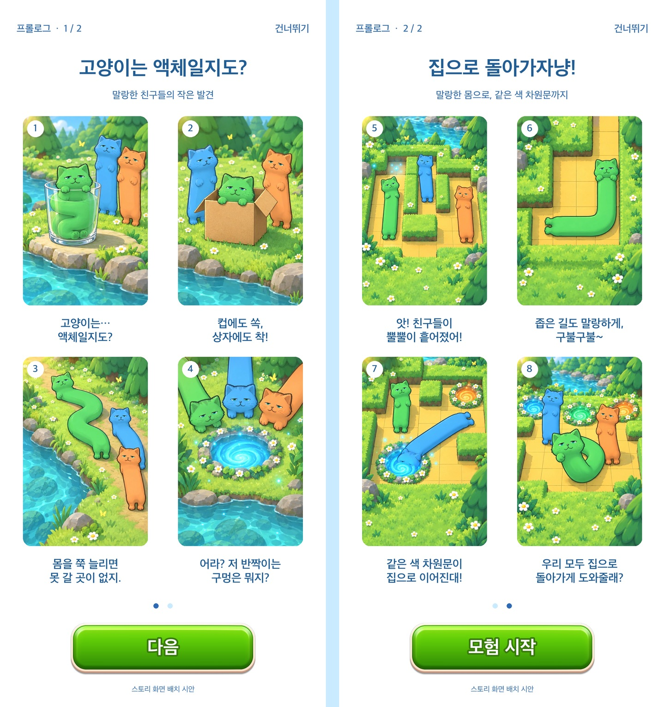

# 고양이는 액체일지도? — 첫 입장 이야기

> **현재 제작본은 [세 번째 버전](revision-03/README.md)이다.** 게임에 맞춘 손그림 만화풍과 무문자 서사로 바꾸고, 한 화면에 네 컷이 순서대로 박히는 [모션 GIF](revision-03/stamp-preview.gif)를 제작했다. 배포용 WebP와 스토리 JSON도 세 번째 버전이다. 아래 내용과 이 폴더 바로 아래의 원화·프롬프트·미리보기는 채택되지 않은 첫 버전의 기록이다.

2026-11-15. 현재 게임 화면을 참조해 Sunburst로 4컷씩 2페이지를 제작했다. 현재 상태는 **그림·대사·배치 시안 제작 완료 / 게임 씬 연결 대기**다.

## 파일

- `page-01-generated.png`, `page-02-generated.png`: Sunburst가 반환한 1024×1536 원화. 텍스트나 버튼이 없다.
- `page-01-preview.png`, `page-02-preview.png`: 실제 모바일 비율인 393×852의 3배 해상도로 만든 문구·버튼 배치 시안. 동작하는 UI가 아니다.
- `../../src/assets/story_cat_liquid_page_01.webp`, `_02.webp`: 게임에서 사용할 수 있는 4컷 원화 2장.
- `../../src/assets/story_cat_liquid_panel_01.webp`~`_08.webp`: 각 컷 500×756. 비율을 보존해 배치한다.
- `../../resources/story/cat-liquid-intro.json`: 제목·대사·버튼 문구와 표시 정책. 아직 게임에서 읽지 않는다.
- `ui-editor-handoff.md`: UI Editor 씬·버튼·최초 입장 분기의 연결 명세와 현재 제약.
- `page-01.prompt.txt`, `page-02.prompt.txt`, `generation.json`: 실제 사용한 프롬프트·참조·모델·사용량 기록.
- `asset-manifest.json`: 제공 이미지의 해시·크기. 이 파일은 제작 후 자동 집계한다.

이야기는 컵·상자에 맞춰 몸을 접는 고양이 → 몸 늘리기 → 차원문 발견 → 퍼즐 정원에서 흩어짐 → 몸 구부리기 → 같은 색 차원문 → 플레이어에게 도움 요청으로 진행한다. 마지막 `모험 시작`은 로비로 연결할 예정이며, 자동 스테이지 시작이나 하트 소비를 의미하지 않는다.

## 그림체와 제작

실제 로비의 숲·물·잔디와 인게임의 직선/L자 고양이, 차원문 캡처를 모아 첫 이미지 요청의 참조로 제공했다. 두 번째 요청에는 첫 페이지와 실제 게임 캡처를 함께 제공했다. 녹색·파랑·주황의 세 고양이, 졸린 눈, 길쭉한 몸, 옅은 색 외곽선과 둥근 꽃테 차원문을 기준으로 했다.

기존 로비의 `home_btn_stage_normal.png`를 실제 수평 slice 설정(left 49, right 46)대로 시안 버튼에 사용했다. 게임의 새 HTML UI는 만들지 않았다. 한국어 문구는 macOS의 Apple SD Gothic Neo로 따로 합성했으며, 원화·배포용 WebP에는 글자를 굽지 않았다. 게임 UI에서는 기존 글꼴 설정과 시스템 한글 폴백을 사용하도록 명세했다.

이 그림은 실제 3D 메시나 셰이더를 다시 렌더한 결과가 아니다. 실제 게임과 픽셀 단위로 같은 그림체라는 판정은 하지 않는다. 사용자의 그림체·대사 선호 및 최종 게임 UI 확인이 필요하다.

## 확인

- 두 원화를 열어 각 4컷, 컵·상자 장면, 세 고양이의 색/얼굴 일관성, 늘어나는 몸, L자 굽힘, 같은 색 차원문을 확인했다.
- 모바일 배치 시안을 열어 2열×2행의 읽는 순서, 대사 두 줄, 제목·그림·대사·버튼 사이 간격을 확인했다.
- 원화 2장과 개별 8컷의 WebP를 모두 디코드하고 중복 경로가 없음을 확인했다. 대사는 1~8 순번의 두 줄씩이며, 전체 WebP 용량은 1,668,068바이트다.
- 현재 publish-report errors는 0개다. 새 스토리 씬·이벤트가 없어 첫 입장·다음·건너뛰기·완료 저장은 아직 실행 검사하지 않았다. 기존 게임 흐름은 수정하지 않았다.

## Sunburst 사용량

모델: `gpt-image-2.5-sunburst`. Flava의 스킬 기본 스크립트를 사용한 참조 이미지 편집 2회, high 품질, 재시도 없음.

| 요청 | 입력 텍스트 토큰 | 입력 이미지 토큰 | 출력 이미지 토큰 | 추정 USD | 추정 KRW |
| --- | ---: | ---: | ---: | ---: | ---: |
| 1페이지 | 1,008 | 1,536 | 1,372 | $0.029244 | ₩40.94 |
| 2페이지 | 998 | 1,521 | 1,372 | $0.029159 | ₩40.82 |
| 합계 | 2,006 | 3,057 | 2,744 | $0.058403 | ₩81.76 |

응답의 실제 사용량에 스킬 단가와 고정 환율 $1=₩1,400을 적용한 추정치다.

## 출처

Marc-Antoine Fardin, *On the Rheology of Cats*, Rheology Bulletin 83(2), July 2014, pp. 16–17, 30. [2017 이그노벨 물리학상 공식 소개](https://improbable.com/ig/winners/#ig2017)에서 제목·저자·발표 정보를 확인했다. 이 만화는 고양이의 유연함을 유변학에 빗댄 유머에서 영감을 얻은 창작이며, 고양이가 실제 액체라는 과학적 증명을 주장하지 않는다.
