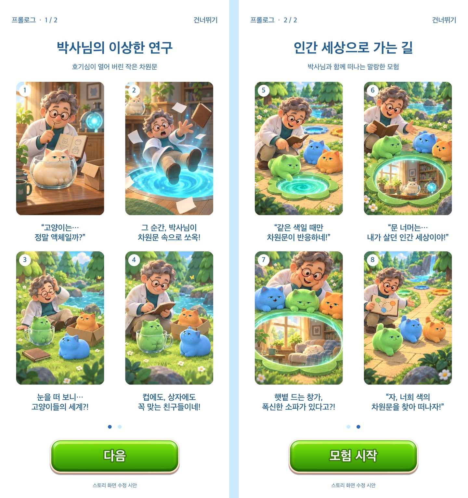

# 고양이 유동학 박사와 인간계로 가는 모험 — 두 번째 시안

2026-11-15. 사용자가 첫 시안의 긴 몸과 평면적인 외형을 지적하고, 박사가 차원문에 빨려 들어가 컵고양이·박스고양이를 만나 인간계로 가는 길을 알려주는 줄거리를 제안했다. 이에 따라 원화 2페이지와 한국어 문구를 새로 제작했다. 현재는 **게임 연결 전 수정 시안**이다.

## 이야기와 외형

1. 박사가 집 안 연구실에서 용기에 들어간 고양이를 관찰한다.
2. 실험 중 생긴 차원문으로 박사가 빨려 들어간다.
3. 고양이 세계에서 녹색 컵고양이·주황 박스고양이·파란 고양이를 만난다.
4. 박사가 용기에 꼭 맞는 고양이들의 몸을 기록하며 친해진다.
5. 녹색 고양이가 녹색 문을 만지자 반응하는 것을 관찰한다.
6. 문 너머로 박사의 연구실이 보여 인간계로 이어짐을 알아낸다.
7. 고양이들이 햇볕 드는 창가와 소파를 보고 관심을 보인다.
8. 박사가 색상별 경로를 설명하고 고양이들이 모험을 떠난다.

박사는 논문의 모티브를 살린 가상 인물이다. 흰 가운·청록색 니트·둥근 안경·회갈색 머리·갈색 수첩을 두 페이지에서 유지했다. 연구실의 크림색 집고양이는 인간계를 알아보는 시각 단서다.

고양이는 긴 튜브 형태를 사용하지 않고 짧고 통통한 기본형으로 만들었다. 기존 게임의 졸린 눈·작은 코와 입·귀·녹색/파랑/주황 팔레트를 참조했다. 비스듬한 카메라, 둥근 볼·가슴·배의 부드러운 음영, 바닥/용기 접촉 그림자, 유리 두께와 몸의 겹침을 표현하도록 요청했다. 짙은 검은 윤곽선은 제외했다. 실제 원화에서 이 요소들을 확인했다. 원래 3D 메시·셰이더를 다시 렌더한 것은 아니므로 게임과 동일한 렌더라고 주장하지 않는다.

## 제공 파일

- `page-01-generated.png`, `page-02-generated.png`: 글자 없는 1024×1536 원화.
- `page-01-preview.png`, `page-02-preview.png`: 393×852 비율의 3배 해상도 모바일 시안. 실제 게임 버튼은 아니다.
- `two-page-preview.jpg`: 두 페이지를 나란히 보여주는 확인 이미지.
- `page-01.prompt.txt`, `page-02.prompt.txt`, 참조 PNG, `generation.json`: 실제 생성 입력과 사용량.
- `../../../src/assets/story_cat_liquid_page_01.webp`, `_02.webp`: 현재 4컷 원화 2장.
- `../../../src/assets/story_cat_liquid_panel_01.webp`~`_08.webp`: 현재 개별 8컷, 각 500×756.
- `../../../resources/story/cat-liquid-intro.json`: 수정한 제목·대사·표시 정책. 대사는 이미지와 분리되어 있다.
- `../asset-manifest.json`: 현재 배포용 이미지의 크기·용량·SHA-256.
- `../ui-editor-handoff.md`: 씬과 버튼을 추가할 때의 연결 명세. 기존 UI 씬·이벤트 직접 생성 제한은 해제되지 않았다.

원본 첫 시안은 상위 폴더에 보관하고, 배포용 WebP 10개와 스토리 JSON은 이 버전으로 교체했다. 두 가지 WebP 묶음(페이지/개별 컷)은 선택지이므로 실제 UI에서 중복 로드하지 않는다.

## 확인

원화 두 장을 열어 4컷 구성, 박사의 안경·의상·머리·수첩, 짧고 통통한 세 고양이, 컵/상자 장면, 같은 색 문과 인간계 단서, 모험 시작 장면을 확인했다. 모바일 시안에서는 전체 컷을 contain으로 배치했고, 번호·대사 두 줄·제목·버튼 간격을 확인했다. 각 대사 줄의 글자 폭도 표시 영역 174px 이내인지 측정했다.

배포용 WebP 10개를 모두 디코드하고 경로·1~8 순번·해시를 확인했다. 총 용량은 1,544,550바이트다. 게임 실행 로직·카메라·이동·씬 흐름에는 변경이 없으므로 이번 수정에 대해 게임 동작/브라우저 렌더 검사를 했다고 보고하지 않는다. 최종 그림체와 대사 선호는 사용자 확인 대상이다.

## 이번 수정의 Sunburst 사용량

`gpt-image-2.5-sunburst`, Flava의 스킬 기본 스크립트, high 품질, 참조 이미지 편집 2회. 첫 페이지에는 실제 게임의 얼굴·환경 캡처, 두 번째에는 새 첫 페이지와 실제 게임 얼굴/환경을 참조로 사용했다. 이전의 거절된 생성 이미지는 이번 생성 참조에 넣지 않았다.

| 요청 | 입력 텍스트 토큰 | 입력 이미지 토큰 | 출력 이미지 토큰 | 추정 USD | 추정 KRW |
| --- | ---: | ---: | ---: | ---: | ---: |
| 1페이지 | 1,338 | 1,536 | 1,372 | $0.030069 | ₩42.10 |
| 2페이지 | 1,267 | 1,521 | 1,372 | $0.0298315 | ₩41.76 |
| 합계 | 2,605 | 3,057 | 2,744 | $0.0599005 | ₩83.86 |

응답이 보고한 사용량과 스킬 단가, 고정 환율 $1=₩1,400에 따른 추정치다. 이번 수정에서 재시도나 추가 요청은 없었다.
