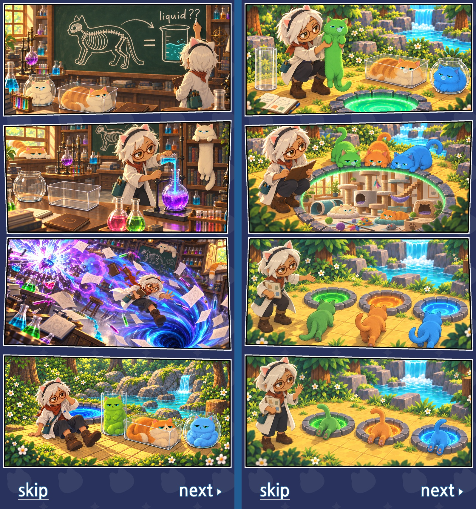

# 칠판 가설 → 고양이 소동 → 배합 폭발

과거 revision15 기록. 현재 적용본은 [revision16](../revision-16/README.md)이다. 사용자가 선택한 18:43:49 캐릭터를 기준으로 흰색 단발과 고양이 귀 머리띠를 적용했다. 따뜻한 갈색 피부·호박색 눈·가는 갈색 둥근 투명 안경·빨간 머플러·흰 가운·어린 비율을 유지한다. 앞선 버전의 두꺼운 빨간 안경으로 되돌리지 않는다.

## 여덟 컷

1. 큰 칠판을 부각하고, 박사가 뒤돌아 서서 고양이 골격/해부도 = 청록 액체 비커와 `liquid??`를 분필로 적는다. 책은 손이나 작업대가 받치고 있다.
2. 박사는 플라스크 배합에 몰두한다. 크림 고양이는 책장 모서리에 상체를 편하게 받친 채 길게 늘어져 매달리고, 주황 고양이는 반쯤 열린 창문으로 스스로 납작해져 들어온다. 두 고양이는 나른한 표정이며 기존 병과 상자는 비어 있다.
3. 거대한 청록·보라 섬광이 터지고 연구실·종이·옷자락이 비틀리며 바닥의 깊은 회오리로 휘말린다. 박사도 대각선으로 빨려 들어가며 목적지는 다음 컷에 드러난다. 효과음 글자는 없다.
4. 숲 고양이 세계에 도착해 주저앉은 박사가 어리둥절해한다.
5. 초록 고양이의 상부 가슴을 부드럽게 받쳐 드니 몸이 중력으로 길게 늘어진다. 고양이는 나른한 눈과 작은 콧방울로 졸고 있다. 몸을 당기는 실험이 아니다.
6. 바닥 차원문 너머 인간계에는 캣타워·해먹·스크래처·터널·숨숨집·공·깃털·장난감 쥐가 있는 고양이 놀이방이 보인다.
7. 세 고양이에게 같은 색 바닥 차원문을 안내한다.
8. 고양이가 차원문으로 들어가고 박사는 배웅한다.

연구실은 회색 마감 타일과 플라스크·칠판·연구 자료로 구성된다. 인간계 목적지는 별도의 고양이 놀이방이다. 고양이 몸과 어깨/엉덩이를 둥글게 하고, 뒷모습의 꼬리는 골반 위에서 자연스럽게 이어져 가늘어지는 곡선으로 표현했다. 앞발2·뒷발2·꼬리1의 연결과 느긋한 게임 표정을 확인했다. 긴 몸은 만화적 과장이다.

## 적용과 확인

`resources/story/cat-liquid-intro.json` revision15와 `story_cat_liquid_mishap_*` WebP를 UI Editor 원본/실행 contract에 함께 연결했다. 1·2·3·6컷 변경은 각 짝 이미지의 다른 승인 컷을 픽셀 그대로 보존해 합성했다. 합성 기록은 `*-composition.json`에 있다.

기존 두 페이지/세로 누적 네 컷/상점 배경/skip·next ▶/완료 저장을 유지한다. UI 대사·설명은 없으며, 사용자가 요청한 칠판의 `liquid??`만 그림에 포함된다. 새 함수·이벤트·흐름·매니저·Godot·게임성·카메라 수정 없음. 스토리 엣지5 유지, 추가0/제외0. 시작 캐시 오류 수정도 유지한다.

`story_intro_check.mjs`, `ui_bare_asset_paths_check.mjs`, `splash_cache_check.mjs` 통과. 8컷 분리·WebP 디코드/해시와 HTTP 리소스14개 일치 검사 통과. 기존 publish errors0/warnings8. 최종 원화와 전체 배치 이미지를 로컬로 열어 확인했다. PNG/JPG/GIF는 **오프라인 미리보기**이며 게임 캡처가 아니다. 실제 브라우저·게임 시각 확인은 사용자 담당이다.

[게임에서 다시보기](http://localhost:8080/web/?story=replay&art=15).

## 생성 사용량

Sunburst 스킬의 `scripts/generate_image.py` → Flava, `gpt-image-2.5-sunburst`, high. 이번 revision15 전체9회(중간 시안/구도 수정 포함), 실패0/자동 재시도0. 입력 텍스트9,144·입력 이미지10,752·출력 이미지15,804토큰, 추정 **$0.3029280 / ₩424.10**($1=₩1,400). 이전 버전 사용량은 제외했다. 응답별 기록은 `generation-summary.json`에 있다.
