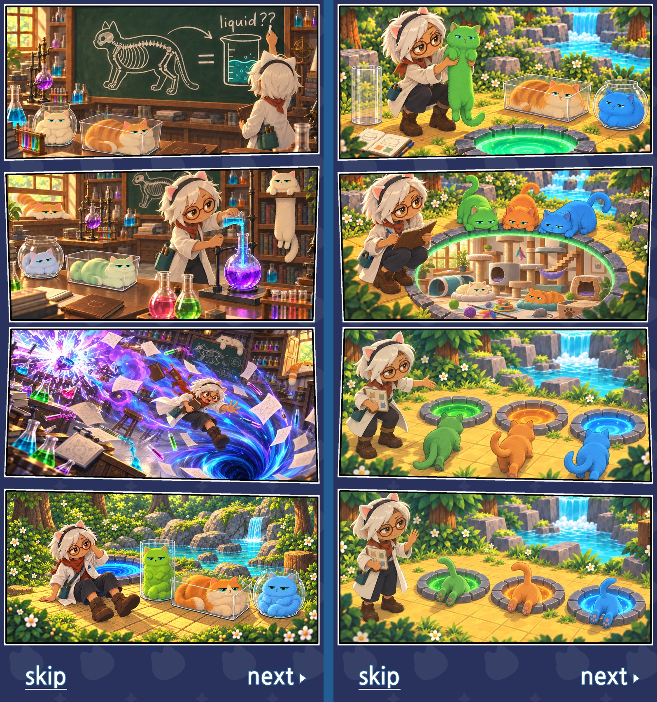

# revision16 — 터치/자동 진행과 그림 보정

화면 아무 곳이나 클릭/터치하면 다음 컷을 공개한다. 입력이 없으면4초 뒤 한 컷을 진행한다. 수동 진행마다 대기 시간을 다시 시작하며, 네 컷이 모두 공개되면 자동 진행을 멈춘다. 이후 배경 터치는 무시하며 next 버튼을 눌러야 다음 페이지로, 마지막 페이지에서는 로비로 이동한다. skip과 next ▶의 기존 동작은 유지하고 버튼 클릭이 화면 터치와 중복 처리되지 않게 했다. next 글자와 ▶가1.2초 주기로 함께 밝아졌다 흐려진다(투명도1↔0.35). 움직임 줄이기 설정에서는 깜빡임을 끈다.

1컷 박사 머리띠 귀는 흰색 뒷면으로 고쳤다. 2컷은 책장/창문 고양이를 유지하면서 둥근 유리 병에 연한 파란 고양이, 사각 유리 그릇에 민트 고양이를 넣었다. 모든 컷의 콧방울을 제거하고 나른한 눈과 편안한 자세는 유지했다. 원화 짝2/4(3·4·7·8컷)는 revision15 파일과 동일하다.

그림 수정은 Sunburst 스킬의 scripts/generate_image.py → Flava, gpt-image-2.5-sunburst high. 이번4회 입력 텍스트1,568/이미지4,096, 출력 이미지7,024토큰. 추정$0.1256640/₩175.93($1=₩1,400). 실패0/자동 재시도0. 개별 사용량은 generation-summary.json에 기록했다.

기존 진행 함수/프레임 루프를 확장했고 새 함수/씬 이벤트/문서 엣지는 만들지 않았다. 기존 스토리 엣지5개 유지, 추가0/제외0. UI Editor 원본과 실행 contract에 새 에셋 경로를 함께 반영했다. Godot/게임성/카메라 수정 없음.

`story_intro_check.mjs`, `ui_bare_asset_paths_check.mjs`, `splash_cache_check.mjs` 및8컷 WebP 디코드/해시 검사를 통과했다. HTTP 리소스14개는 작업 폴더와 바이트가 일치한다. 기존 publish errors0/warnings8.

이미지는 오프라인 배치 미리보기다. 브라우저·실제 게임 시각 확인은 사용자 담당이다. 자동 진행/입력은 renderer 대역과 실제 FlowDriver를 이용한 Node 로직 검사로 확인한다.

[게임에서 다시보기](http://localhost:8080/web/?story=replay&art=16)

후속 적용: 컷이 등장할 때 기존 ui_pop.mp3를 gain0.45로 한 번 재생한다. 자동/터치/키보드에 동일하며 skip/종료 후에는 컷 효과음이 없다. 일반 next 버튼음과 중복하지 않고 기존 SFX설정을 따른다. JS모듈은 cat-liquid-page-gate-v18이다.
