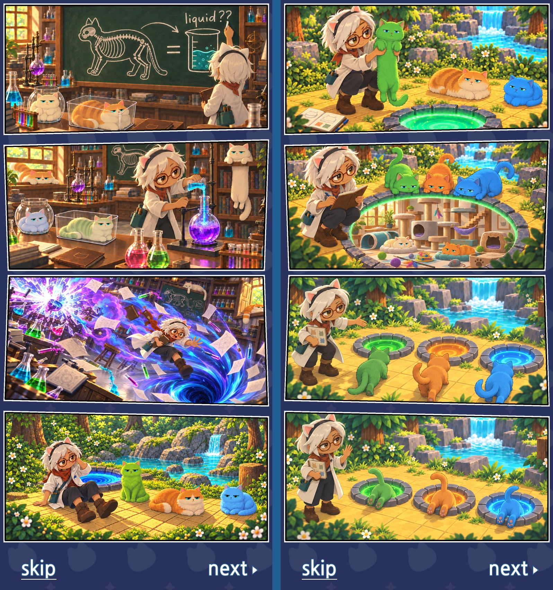

# 고양이 신체 비례와 숲 환경 보정 — revision17

2026-11-15. 게임 데이터와 UI Editor 원본/실행 contract에 반영했다.

- 2컷 사각 그릇의 초록 고양이: 앞발 크기와 손목 연결을 정리하고, 뒷다리와 꼬리를 구분했다.
- 3컷 칠판 위 크림 고양이: 부풀었던 늘어진 팔다리/꼬리를 작은 앞발과 가늘어지는 꼬리로 수정했다. 고양이 주변 작은 영역만 합성했다.
- 4·5컷 숲: 유리병·원통·사각 그릇을 제거하고, 고양이가 땅 위에 직접 앉거나 쉬도록 수정했다. 실험실 1·2컷의 유리 용기는 유지한다.
- 5컷 받쳐 든 고양이는 자연스럽게 길어진 몸과 나른한 표정을 유지한다. 1·6·7·8컷 원화는 이전 버전과 같다.

[신체 비례 전후 비교](anatomy-before-after.jpg) · [만화 다시보기](http://localhost:8080/web/?story=replay&art=17)

## 연결과 검사

`resources/story/cat-liquid-intro.json` revision17, 2~5컷의 `story_cat_liquid_anatomy_*` 경로를 사용한다. 4초 간격 컷 공개, 네 컷 완성 후 next 버튼으로만 다음 페이지/로비 이동, skip, next 깜빡임, 컷 효과음과 발바닥 아이콘은 유지한다.

`story_intro_check.mjs`, `ui_bare_asset_paths_check.mjs`, `splash_cache_check.mjs` 통과. 오프라인 8컷 자르기/WebP 디코드·해시, localhost 14개 리소스의 HTTP 200/작업 폴더 일치 확인. publish errors0/warnings8, 스토리 엣지5개 유지. PNG/JPG는 오프라인 원화/배치이며 실제 게임 캡처가 아니다. 브라우저·게임 시각 확인은 사용자 담당이다.

## 제작 기록

`pair-01~03-uncomposited.png`는 Sunburst 원응답, `pair-01~03-generated.png`는 보존 영역을 원본과 합성한 최종본이다. 4번째 쌍은 revision16 그대로다. `composition-check.json`, `asset-check.json`, `resource-check.json`, `art-review.json`에 검사 범위를 기록했다.

Flava 경유 Sunburst 스킬 `scripts/generate_image.py`, `gpt-image-2.5-sunburst`, high, 3요청, 실패/자동 재시도0. 실제 입력 텍스트2,382·입력 이미지3,072·출력 이미지5,268토큰. 추정 $0.0972630 / ₩136.17 ($1=₩1,400). 개별 응답/프롬프트와 `generation-summary.json` 보존.
