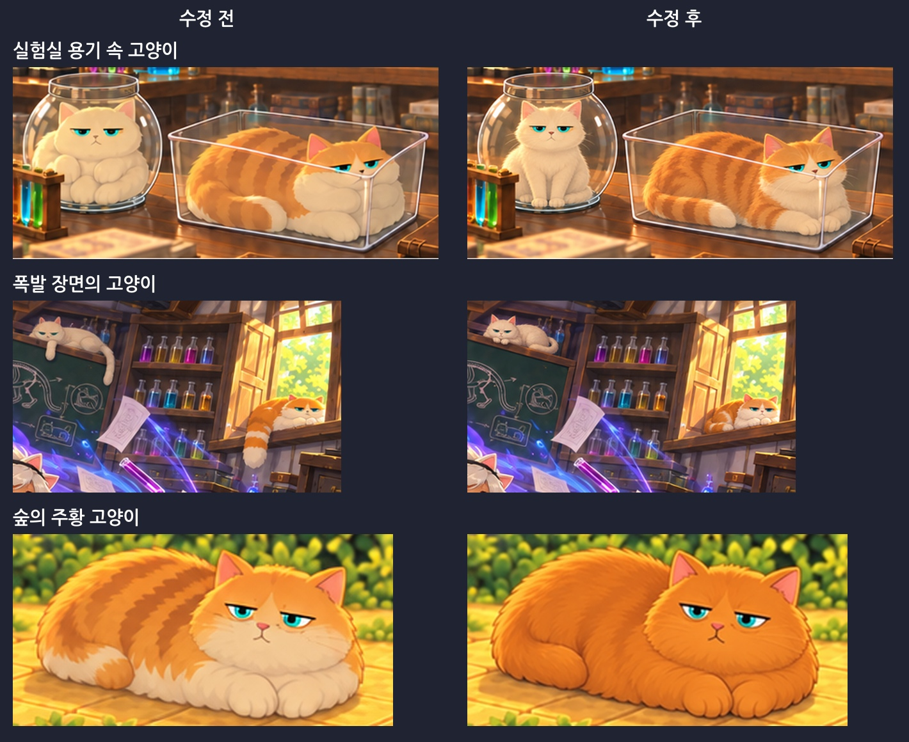

# 고양이 비례·주황 털색·검정 테두리 — revision18

2026-11-15. 사용자의 20:27 고양이 신체 지적, 20:28 털색 연속성 지적, 흰 컷 테두리 변경 요청을 함께 반영했다.

- 1컷 유리병 속 크림 고양이: 가슴 아래로 두 앞다리가 이어지고 작은 발이 바닥에 닿는 앉은 자세. 사각 용기 주황 고양이: 부풀어 겹친 가슴/발 덩어리를 연속된 가슴과 작은 앞발의 엎드린 자세로 보정했다.
- 3컷 칠판 위 크림 고양이: 앞발을 선반에 걸치고 꼬리는 위에서 말아 둔다. 창가 주황 고양이: 두 앞발은 창틀 위에, 몸/뒷다리는 뒤쪽에서 받친다. 길게 늘어진 고무 같은 팔다리/꼬리는 제거했다.
- 4·5컷 고양이 세계의 같은 주황 고양이는 줄무늬와 흰 가슴/주둥이/발/꼬리 끝 없이 단색 주황이다. 인간계 실험실/놀이방의 별도 고양이는 원래 무늬를 유지한다.
- 전체8컷의 흰 테두리를 검정(#111111)으로 바꿨다. 사선 프레임/크기/배치와 컷 등장 모션은 같다.

[검정 테두리 전체 오프라인 배치](two-page-board.jpg) · [게임 다시보기](http://localhost:8080/web/?story=replay&art=18)

## 연결·검사

`resources/story/cat-liquid-intro.json` revision18. 전체 카드/페이지는 `story_cat_liquid_refined_*`, 수정된 원화는1·3·4·5컷만 새 경로다. UI Editor 원본 두 씬과 실행 contract의 이미지 경로를 함께 변경했다. 매니저/런타임 로직/카메라/게임성은 건드리지 않았다. 4초 자동 컷 공개, 네 컷 이후 next 전용 페이지 이동, skip, next 깜빡임, 카드 넘김 사운드 gain0.8을 유지한다.

`story_intro_check.mjs`, `ui_bare_asset_paths_check.mjs`, `splash_cache_check.mjs` 통과. 8컷 WebP 검증,8개 불투명 검정 테두리 샘플, 로컬 HTTP11개 응답200/작업 파일 일치, 원화2·6·7·8 이전 바이트 일치를 확인했다. 기존 publish errors0/warnings8, 흐름 엣지 추가/삭제0. 원화/합성 확대 비교/전체 오프라인 배치를 열어 검사했다. 실제 게임 화면 시각 확인은 사용자 담당이다.

## 제작·보존

Flava 경유 Sunburst 스킬 `scripts/generate_image.py`, 모델 `gpt-image-2.5-sunburst`, high,3요청, 실패/자동 재시도0. 실제 입력 텍스트1,550·입력 이미지4,096·출력 이미지4,500토큰. 추정 $0.0877590 / ₩122.86 ($1=₩1,400).

작은 고양이를 포함한 전체 장면을 재생성하지 않고 지역 확대 입력으로 편집했다. `scene-01/03-edit-output.png`, `world-color-edit-output.png`는 원응답이며 기존 원화에 마스크로 합성했다. 마스크 밖 픽셀은 원래 쌍 이미지에서 유지한다. `composition-check.json`, `asset-check.json`, `resource-check.json`, `art-review.json`, `generation-summary.json`에 범위와 실제 검사/사용량을 기록했다. 초기 사용자 스크린샷과 `story-before.json`을 보존했다.
