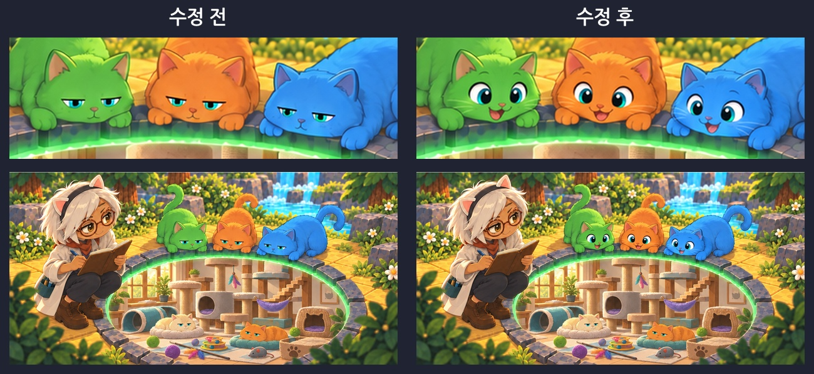

# 놀이방 발견의 신난 표정 — revision19

2026-11-15. 둘째 페이지의 두 번째 컷(전체6컷)에서 숲의 초록/주황/파랑 고양이가 놀이방을 발견하고 눈을 크게 뜨며 웃도록 수정했다. 둥근 큰 동공과 청록 홍채/자연스러운 반사광을 사용하며, 다른 컷의 나른한 표정과 대비된다.

[게임 다시보기](http://localhost:8080/web/?story=replay&art=19)

지역 확대 입력을 Sunburst로 편집한 뒤 세 얼굴 부분만 마스크로 원본에 합성했다. 귀/머리 바깥 윤곽, 몸 비례와 꼬리, 차원문에 얹은 발, 박사, 놀이방 내부와 바닥 차원문은 유지한다. 다른7컷 원화/카드, 검정 테두리, 단색 주황 털, 자동 공개/네 컷 뒤 next 전용 페이지 이동, skip/next깜빡임/카드 넘김 소리는 유지한다. 추가 대사/기호/이펙트는 없다.

스토리 revision19. `story_cat_liquid_discovery_panel_06.webp`, `story_cat_liquid_discovery_card_06.webp`, `story_cat_liquid_discovery_page_02.webp`와 StoryIntro02의 원본/실행 contract에 반영했다. PNG/JPG는 원화와 오프라인 배치이며 실제 게임 캡처가 아니다. 게임 시각 확인은 사용자 담당이다.

Flava 경유 Sunburst 스킬 `scripts/generate_image.py`, 모델 `gpt-image-2.5-sunburst`, high,1요청, 실패/자동 재시도0. 실제 입력 텍스트537·입력 이미지1,536·출력 이미지1,372토큰. 추정 $0.0280665 / ₩39.29 ($1=₩1,400). 실제 응답/프롬프트, 얼굴 마스크, 합성 기록/이전 데이터/검사 기록을 보존한다.
