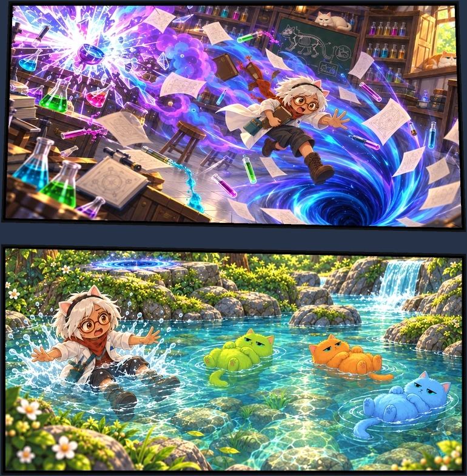

# 물 위 도착과 박사의 다리 구조 — revision20

2026-11-15. 첫 페이지의 3·4컷을 수정했다.

- 3컷: 사용자가 지적한 골반/다리 겹침과 부츠 밑의 추가 발처럼 보이는 형태를 수정했다. 뒤쪽 다리를 옆으로 굽혀 부츠 두 개가 분리되어 보이도록 했다. 확대 지역 Sunburst 편집 뒤 하체 마스크 영역만 원본에 합성해 얼굴/머리/손/책과 주변 폭발은 유지한다.
- 4컷: 숲속 맑은 물 위에 초록/단색 주황/파랑 고양이가 배를 위로 드러내고 이미 쉬고 있다. 박사만 물에 풍덩 빠져 놀라는 구도로 연구실에서 고양이가 함께 따라온 인상을 줄인다. 물속 돌/수초, 몸에 닿는 작은 물결과 그림자, 배경의 수평 도착 차원문을 넣었다.

[게임 다시보기](http://localhost:8080/web/?story=replay&art=20)

다른 여섯 컷은 유지하며, 특히6컷의 큰 눈/신난 표정은 유지한다. 같은 박사 디자인/네 발과 꼬리/단색 털/검정 프레임을 따른다. 조작·진행·효과음·게임플레이 코드 변경 없음. 이전 데이터와 생성 응답/프롬프트/지역 마스크/합성 기록을 보관한다. 그림과 배치 파일은 원화 및 오프라인 배치이며 실제 게임 캡처가 아니다. 브라우저 시각 검증은 사용자 담당이다.

Flava 경유 Sunburst 스킬 scripts/generate_image.py, gpt-image-2.5-sunburst, high2요청, 실패/자동 재시도0. 실제 입력 텍스트1,284·입력 이미지2,048·출력 이미지3,512토큰. 추정 $0.0640820 / ₩89.71 ($1=₩1,400).

검사: story_intro_check, ui_bare_asset_paths_check, splash_cache_check, git diff --check 통과. localhost7개 리소스 응답은 작업 폴더와 일치. 다른6컷 원화/카드는 바이트 동일. publish errors0/warnings8 유지, 새 배선 없음.
