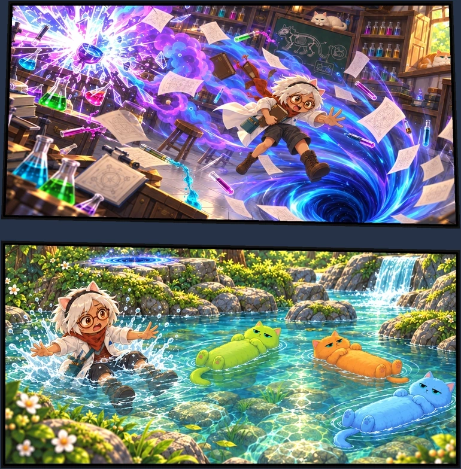

# 뒤쪽 다리 연결과 길쭉한 물 위 고양이 — revision21

2026-11-15. 사용자 추가 지적에 따라3컷의 뒤쪽 다리를 다시 그렸다. 무릎을 바짝 접는 대신 아래 왼쪽으로 펴고, 허벅지에서 무릎·종아리·발목·부츠로 이어지게 했다. 앞쪽 부츠와 상체는 원본을 유지한다. 새 다리와 겹치는 기존 시험관의 일부가 남지 않도록 전체 실루엣을 정리했다.

4컷에서는 세 고양이의 머리/발 크기를 유지하며 어깨에서 골반 사이 몸통을 길게 했다. 배를 하늘로 향한 부유 자세, 나른한 눈, 단색 털, 네 발과 가느다란 꼬리를 유지하고, 물결/그림자도 새 몸 길이를 따른다. 고양이/주변 물만 지역 합성해 박사는 원래 그림 그대로다.

[게임 다시보기](http://localhost:8080/web/?story=replay&art=21)

다른6컷, 특히6컷 신난 표정은 유지. 기존 진행·버튼·효과음·게임플레이 코드 변경 없음. UI Editor 원본과 실행 contract의3·4컷 그림 경로만 바꾼다. 원화/확대 비교/오프라인 배치는 게임 캡처가 아니며 실제 브라우저 시각 확인은 사용자 담당이다.

Flava 경유 Sunburst 스킬 scripts/generate_image.py, gpt-image-2.5-sunburst, high2요청, 실패/자동 재시도0. 입력 텍스트1,388·입력 이미지2,048·출력 이미지3,512토큰. 추정 $0.0643420 / ₩90.08 ($1=₩1,400).

검사: story_intro_check, ui_bare_asset_paths_check, splash_cache_check, git diff --check 통과. localhost7개 리소스가 작업 폴더와 일치. 다른6컷 원화/카드 바이트 동일. publish errors0/warnings8, 새 배선 없음.
