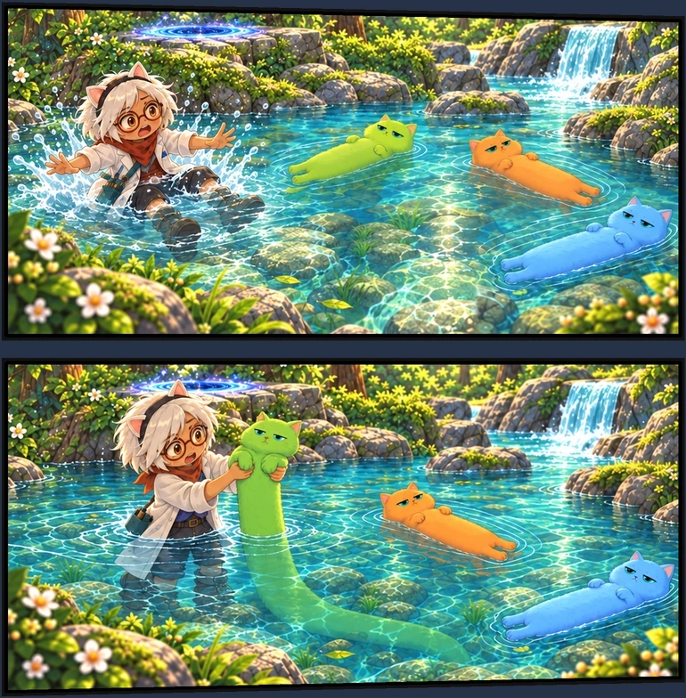

# 로비 고양이 형태와 물속 건져 올리기 — revision22

2026-11-15.4·5컷만 수정했다.

4컷은 실제 저장된3D 로비 화면을 참조로 사용했다. scripts/lobby_floating_cats.gd가 CatEntity의 water_yang/cat1.fbx를 그대로 사용하는 것도 확인했다. 로비처럼 매끈하고 길쭉한 몸통, 가슴에 붙은 작은 앞발, 몸의 축을 따라 짧게 뻗는 두 뒷다리와 발 사이 틈을 적용했다. 이전의 커다란 발바닥과 바나나 같은 꼬리를 정리했다. 고양이/주변 물만 합성해 박사는 원래 픽셀을 유지한다.

5컷은 바로 같은 숲속 물에서 이어진다. 물에 선 박사가 두 손으로 초록 고양이의 가슴 아래를 받쳐 건져 올리자 긴 몸이 수면 아래로 계속 이어진다. 박사는 신기해서 놀라고 고양이는 나른한 뚱한 표정이다. 주황/파랑은 같은 로비형 다리/몸 디자인으로 옆에 떠 있다. 길이를 재거나 두 끝을 잡아당기는 실험이 아니다.

[게임 다시보기](http://localhost:8080/web/?story=replay&art=22)

실제 저장된 로비 참조는 lobby-model-reference.png와 lobby-reference-facts.json. 이미지 생성 입력에는 직접 참조를 넣었다. 최신 브라우저에서 로비를 새로 캡처한 것은 아니다. 생성 이미지와 최종 카드/오프라인 배치를 대조하며 실제 게임/브라우저 시각 확인은 사용자 담당이다. 다른6컷/진행/효과음/게임플레이는 유지하고, 양쪽 UI Editor 원본과 실행 contract는4·5컷 그림 경로만 교체했다.

Flava 경유 Sunburst 스킬 scripts/generate_image.py, gpt-image-2.5-sunburst, high2요청, 실패/자동 재시도0. 입력 텍스트1,655·입력 이미지2,048·출력 이미지3,512토큰. 추정 $0.0650095 / ₩91.01 ($1=₩1,400).

검사: story_intro_check, ui_bare_asset_paths_check, splash_cache_check, git diff --check 통과. localhost9개 리소스 응답은 작업 폴더와 일치. 다른6컷 원화/카드 바이트 동일. publish errors0/warnings8, 새 배선 없음.
