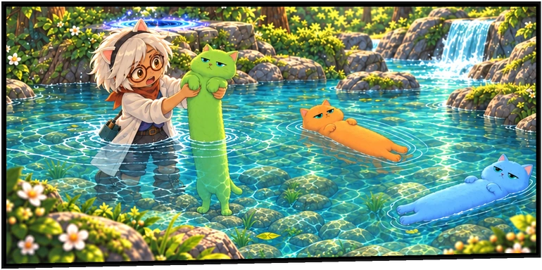

# 고양이 두 뒷발이 계곡 바닥에 닿도록 — revision23

2026-11-15.5컷의 수중 몸통만 보정했다. 뱀처럼 옆으로 길게 휘던 부분을 제거하고, 수직에 가까운 유한한 몸통 아래에 골반·두 짧은 뒷다리·작은 고양이 발을 그렸다. 두 뒷발은 물속 바닥 돌 위에 닿으며 접촉 그림자와 물 굴절/빛무늬를 따른다. 꼬리는 별도의 짧은 형태다.

[게임 다시보기](http://localhost:8080/web/?story=replay&art=23)

지역 확대 편집 뒤 하체/기존 긴 몸통 제거 영역만 합성했다. 박사·손·고양이 머리/표정/앞발과 수면 위 자세, 주황/파랑 고양이는 원래 그림이다. 다른7컷/진행/효과음/게임플레이는 유지하며 StoryIntro02 원본/실행 contract의5컷 이미지 경로만 바꿨다. 마스크·생성 응답·이전 스토리·전후 비교를 보존한다. 오프라인 원화/배치 확인이며 실제 브라우저 시각 확인은 사용자 담당이다.

Flava 경유 Sunburst 스킬 scripts/generate_image.py, gpt-image-2.5-sunburst, high1요청, 실패/자동 재시도0. 입력 텍스트762·입력 이미지1,024·출력 이미지1,756토큰. 추정 $0.032341 / ₩45.28 ($1=₩1,400).

검사: story_intro_check, ui_bare_asset_paths_check, splash_cache_check, git diff --check 통과. localhost5개 리소스 일치. 다른7컷 원화/카드와1페이지 바이트 동일. publish errors0/warnings8, 새 배선 없음.
