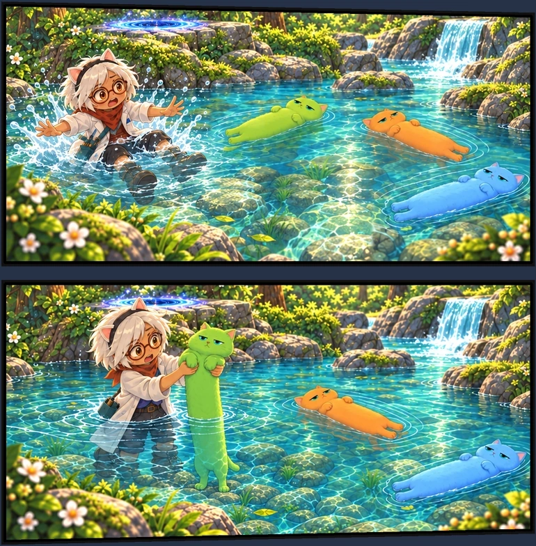

# 수면에 머리를 편히 기대는 고양이 — revision24

2026-11-15.4컷의 초록/주황/파랑과5컷의 주황/파랑, 총 다섯 떠 있는 고양이의 머리/목을 수정했다. 머리 뒤와 목이 등/어깨와 이어져 물에 받쳐지도록 낮추고, 얼굴은 위를 향해 편하게 눕혔다. 귀 각도도 완만하며 눈·코·입은 수면 위에 있다. 기존 몸통 길이/발/털색/나른한 표정은 유지한다.

[게임 다시보기](http://localhost:8080/web/?story=replay&art=24)

머리/목/주변 물 부분만 원본에 합성했다. 두 박사,5컷에 세워 든 초록 고양이 전체는 원래 픽셀이다. 바로 앞 revision23의 유한한 수중 몸통·두 짧은 뒷다리·계곡 바닥 돌에 닿는 두 발을 유지한다. 다른6컷/진행/효과음/게임플레이를 유지하며 양쪽 UI 원본/실행 contract는4·5컷 그림 경로만 바꾼다. 실제 게임 캡처가 아닌 오프라인 원화/배치 확인이며 브라우저 시각 확인은 사용자 담당이다.

이번 revision24: Flava 경유 Sunburst 스킬 scripts/generate_image.py, gpt-image-2.5-sunburst, high1요청. 입력 텍스트692·입력 이미지1,024·출력 이미지1,756토큰, 추정 $0.032166 / ₩45.03.

현재 응답 전체의 revision23 발 교정+revision24 머리 수정 합계: 같은 모델/경로high2요청, 실패/자동 재시도0. 입력 텍스트1,454·입력 이미지2,048·출력 이미지3,512토큰, 추정 $0.064507 / ₩90.31 ($1=₩1,400).

검사: story_intro_check, ui_bare_asset_paths_check, splash_cache_check, git diff --check 통과. localhost9개 리소스 일치. 다른6컷 원화/카드와 세워 든 초록 고양이 원본 보존. publish errors0/warnings8, 새 배선 없음.
