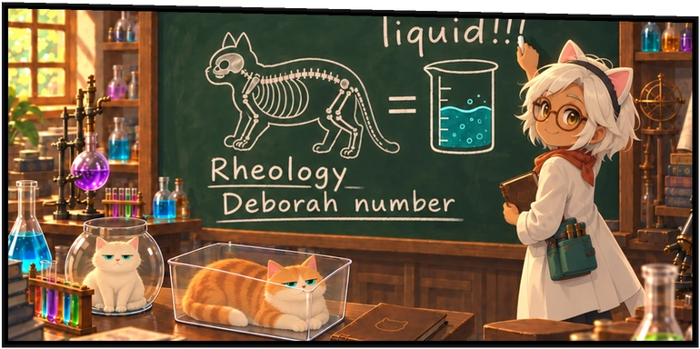

# 칠판의 확신 — revision25

2026-11-15. 사용자가 확인한 대상은 **둘째 페이지 네 번째 컷(전체8컷)**이다. 배웅 장면을 첫 연구실 칠판과 대응하는 결말로 교체했다. 박사가 확신을 얻은 표정으로 `liquid!!!`의 마지막 느낌표를 적으며, 고양이 해부도 `=` 청록색 액체가 담긴 비커, `Rheology`, `Deborah number`가 보인다.

[게임 다시보기](http://localhost:8080/web/?story=replay&art=25)

첫 연구실/기존 마지막 장면의 박사를 한 참조 이미지에 배치해 Sunburst 편집으로 결말을 생성했다. 생성 상단의 참조 그림은 버리고 하단 장면만 원래8컷 영역에 넣었다. 첫7컷 원화/카드14개는 revision24와 SHA256이 같다. 원본7컷과 구분 여백도 픽셀 단위로 보존한다. 검정 프레임/두 페이지 네 컷/자동 공개/next 전용 페이지 이동/skip/효과음/게임플레이/카메라를 유지한다.

## 생성

Flava 경유 `sunburst-image-generation` 스킬의 `scripts/generate_image.py`, `gpt-image-2.5-sunburst`, high1회, 자동 재시도 없음. 입력 텍스트965·입력 이미지1,024·출력 이미지1,756토큰. 추정 **$0.0328485 / ₩45.99** ($1=₩1,400). 실제 응답은 `scene-08-generation.json`, 프롬프트는 `scene-08-conclusion.prompt.txt`에 보존한다.

## 확인

생성 원화/최종 검정 테두리 카드/오프라인 둘째 페이지 배치를 열어 확인했다. 요청한 세 문자열과 해부도=액체 비커, 칠판을 쓰는 동작을 읽어 확인했다. `story_intro_check.mjs`, `ui_bare_asset_paths_check.mjs`, `splash_cache_check.mjs`, `git diff --check` 통과. localhost의 스토리JSON/둘째 contract/새8컷 원화·카드/둘째 페이지 원화5개가 HTTP200이며 작업 파일과 바이트가 같다. publish errors0/warnings8. 새 이벤트/함수/흐름 엣지는 없다. 검사 기록은 `verification.json`과 `asset-check.json`이다.

JPG/PNG/GIF는 오프라인 배치 시안이며 게임 캡처가 아니다. 브라우저·실제 게임 시각 확인은 사용자 담당이다.
