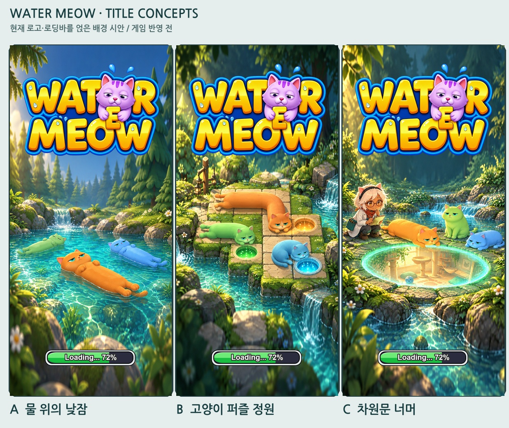

# WATER MEOW 타이틀 배경 시안3종

2026-11-15. 로딩바가 있는 타이틀 화면의 배경 대안을 요청받아 만든 **오프라인 비교 시안**이다. 실행 게임/씬 contract/원본 리소스는 이번 시안 작업에서 변경하지 않았다.

- A 물 위의 낮잠: 로비의 맑은 물과 배를 위로 향해 편히 떠 있는 나른한 고양이.
- B 고양이 퍼즐 정원: 길쭉하고 구부러지는 몸, 돌 타일과 같은 색 바닥 차원문으로 퍼즐 게임을 표현.
- C 차원문 너머: 어린 박사와 고양이들이 바닥 차원문을 통해 고양이 놀이방을 발견.

추천은 B: 고양이의 긴 몸/굽힘/색상 차원문이라는 게임 특징이 가장 직접적으로 드러난다. A는 로비와 분위기를 이어가기에 적합하다.

## 참조와 합성

기존 title_bg.png, 실제 저장된3D 로비 캡처, 현재4컷 숲 물 장면, 선택된 박사 얼굴의 마지막 컷을 참조 보드에 배치했다. 생성은 Sunburst 스킬 `scripts/generate_image.py`를 통한 Flava 참조 이미지 편집3회이며 모델은 `gpt-image-2.5-sunburst`, 품질low(시안), 출력1024×1536이다. 스타일 참조를 이용한 새 그림이며 기존3D 메시의 렌더 캡처가 아니다.

현재 splash.contract.json의 로고/로딩바 좌표·크기를 읽어 원본 title_text.png와 loading_out/inner/bar.png를 그대로 합성했다. 로딩72%는 정적인 표시이며 SceneRenderer 실행 캡처가 아니다. 코딩한 새 UI나 게임 변경은 없다. 세로 화면 중앙 크롭은 가장자리 인물을 잘라서 폐기했다. 최종 시안은 배경 상단/하단 환경 영역만 세로로 확장하고 주요 피사체가 있는y450–1250 영역은 원화 픽셀 그대로1024×2220 캔버스에 옮겼다. 이후 화면2배 크기786×1704로 균등 축소해 캐릭터가 잘리지 않도록 했다. 기존 배경레이어의1.05배 확대/좌표도 미리보기에 반영했다. 구체적인 환경 확장 좌표는 brief.json에 기록했다.

## 파일과 확인

각 이름의 `-generated.png`는 원본 생성 결과, `-background.webp`는 세로 배경, `-preview.png`는 현재 로고/로딩바 합성이다. `comparison.jpg`로 세 시안을 비교한다. 프롬프트·참조 보드·요청별 사용량을 같은 폴더에 보존했다.

반환된 세 원화를 직접 열어 고양이 몸의 연결/발/꼬리/나른한 표정/차원문의 수평 방향/박사 정체성을 확인했다. 최종 비교 이미지를 열어 캐릭터 잘림 수정과 로고/로딩바 영역을 확인했다. 생성 문구나 별도 대사는 없다. 매니페스트는9개 배경/원본/미리보기의 디코드·크기·SHA256을 기록한다. 실제 브라우저 화면 확인이나 게임 적용은 하지 않았다.

## 사용량

입력 텍스트2,057토큰, 입력 이미지4,608토큰, 출력 이미지474토큰. 총추정 **$0.0306845 / ₩42.96** ($1=₩1,400). 3회 모두 정상 응답이며 자동 재시도 없음. 자세한 요청별 값은 usage-summary.json.
