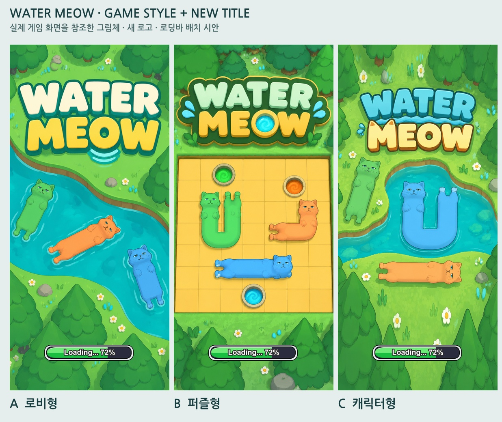

# 실제 게임 그림체와 새 로고 — 타이틀 시안 revision02

2026-11-15. 사용자 요청: 로비/인게임에 그림체를 더 맞추고 타이틀 로고도 새로 디자인한다. 이번 작업은 게임 파일을 변경하지 않는 비교 시안이다.

- A 로비형: 실제 로비와 같은 층진 나무, 밝은 잔디와 청록 물, 나른하게 떠 있는 긴 고양이. 크림/노랑 글자와 청록 옆면/물결 심볼의 새 로고.
- B 퍼즐형: 실제 인게임처럼 노란 격자 보드, U/L/직선 고양이, 같은 색 바닥 차원문. 민트/노랑 글자와 초록 바탕, O의 물결 차원문을 이용한 새 로고.
- C 캐릭터형: U자 고양이를 중심으로 단순한 물/잔디/나무 구성. 물색 WATER와 크림색 MEOW, M의 작은 고양이 귀를 이용한 새 로고.

## 이번 참조와 기준

이전의 생성 일러스트나 만화 그림은 참조에서 제외하고 실제 게임 캡처만 새 참조 보드에 넣었다. `actual-game-only-reference.jpg`는 저장된3D 인게임/로비 화면과 실제 고양이 얼굴 확대다. 각각의 출처는 brief.json에 기록했다. 새 게임/브라우저 캡처를 찍지 않았고 현재 실시간 게임을 시각적으로 검사한 기록도 아니다.

참조에서 추출한 디자인 기준은 고양이의 매끈하고 거의 일정한 너비의 긴 몸통, 작은 앞발/짧게 갈라진 뒷다리, 네모에 가까운 둥근 머리와 뚱한 반쯤 감긴 눈, 얇은 유색 외곽선, 단순한 층진 침엽수, 넓은 색면과3단 음영이다. 사진 같은 털/세밀한 실사 돌/배경 흐림은 줄이는 방향으로 요청했다. 새 이미지들은 참조를 바탕으로 생성한 콘셉트이며 원본3D 메시를 렌더한 결과와 픽셀 단위로 같다고 주장하지 않는다.

## 출력과 배치

`*-generated.png`: 로고와 배경을 함께 디자인한1024×1536 Sunburst 원본. `*-title.webp`: 세로 화면2배 크기786×1704로 맞춘 통합 아트. `*-preview.png`: 여기에 기존 로딩바 원본을 현재 x/y/크기대로 얹은 정적72% 시안. 실제 로딩 UI 실행 캡처가 아니다. 로고와 배경은 현재 한 장의 콘셉트이며 실제 적용 시에는 레이어 분리가 가능하도록 별도 제작할 수 있다.

A/B는 중앙x158–866을 잘라도 주요 로고/고양이/구멍이 유지돼 그대로 세로 비율에 맞췄다. C는 왼쪽 초록 고양이를 살리려고x70–950을 남기고 위0–100/아래1250–1536 환경 부분만 늘려880×1908을 만든다. 가운데 로고/모든 고양이가 있는y100–1250은 원화 픽셀 그대로 옮긴 뒤 전체를 균등 축소한다. build_previews.py가 이 과정을 재현한다.

## 확인

반환된 원본3개를 열어 WATER MEOW 철자, 로고 차별화, 실제 게임 형태를 반영한 긴 몸/작은 발/나른한 눈/층진 나무/넓은 음영을 확인했다. B 차원문은 바닥면에 놓여 있고 캐릭터가 가려지지 않는다. 최종 세로 비교 이미지를 열어 로고와 고양이 잘림/로딩바 겹침이 없는지 확인했다. 각 원본/세로 아트/미리보기9개는 디코드/크기/SHA256 매니페스트를 보존한다. 원본게임·런타임·publish 산출물 변경은 없다.

## 생성과 비용

Sunburst 스킬의 scripts/generate_image.py → Flava 경유, 모델 gpt-image-2.5-sunburst, low 품질 시안3요청, 모두 정상 응답/자동 재시도 없음. 이번 revision02 입력 텍스트2,845·입력 이미지4,608·출력 이미지474토큰. 추정 **$0.0326545 / ₩45.72** ($1=₩1,400). 요청별 값과 합계는 usage-summary.json에 보존한다.
