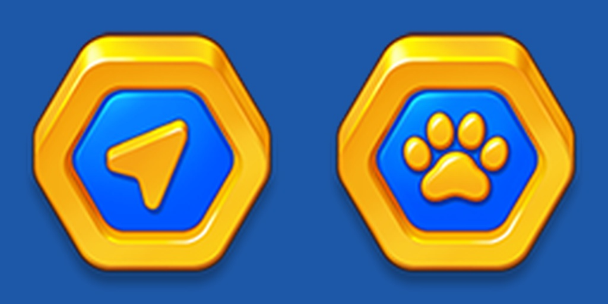

# 홈 탭 — 금색 고양이 발바닥

사용자 스크린샷과 실제 icon_menu_home_1.png를 확인하고, 같은 금색 입체/베벨/광택으로 네 발가락 패드와 큰 발바닥 패드의 문양을 제작했다. 화살표가 있던 파란 안쪽 영역만 합성했으며 원래 금색 테두리와128×128크기·투명도를 보존했다. 마스크 밖 픽셀과 알파 채널이 그대로인지 검사했다.

적용 파일은 src/assets/icon_menu_home_1.png 및 웹에서 읽는 루트 icon_menu_home_1.png다. UI 씬/이벤트/레이아웃/터치 영역은 변경하지 않았다. 기존 시작 이미지 캐시에 옛 화살표가 남지 않게 두HTML의 SPLASH_CACHE_VERSION을 home-paw-story-sfx-v4로 갱신했다. 원본 두 파일은 이 폴더에 보존했다.

이전 요청의 컷 등장 소리도 연결했다. 기존 SoundManager.playSfx와 ui_pop.mp3를 개별 gain0.45로 사용한다. 컷 공개 함수에서만 한 번 호출하며 자동/화면 터치/next/키보드에 동일 적용한다. skip/완료 뒤에는 컷 소리를 내지 않는다. 기존 SFX토글과 매니저의 뮤트/볼륨/첫 제스처 정책을 따른다. next 클릭의 일반 버튼음을 제외해 컷 효과음과 겹치지 않게 했다. 씬 흐름 엣지는 기존5개 유지, 추가0/제외0. publish errors0, 기존 warnings8.

검사: story_intro_check.mjs(컷당1회/8컷 자동재생/skip/종료 후 무호출 포함), ui_bare_asset_paths_check.mjs, splash_cache_check.mjs 통과. HTTP5리소스가 작업 폴더와 동일. 아이콘 생성 원화/합성 비교 이미지를 로컬로 열어 확인했다. 브라우저·실제 게임의 시각/청음 검사는 수행하지 않았다.

생성: Sunburst 스킬 scripts/generate_image.py → Flava, gpt-image-2.5-sunburst high1회. 입력 텍스트394·이미지1,024·출력 이미지1,756토큰. 추정$0.031421/₩43.99($1=₩1,400). 실패0/자동 재시도0.

